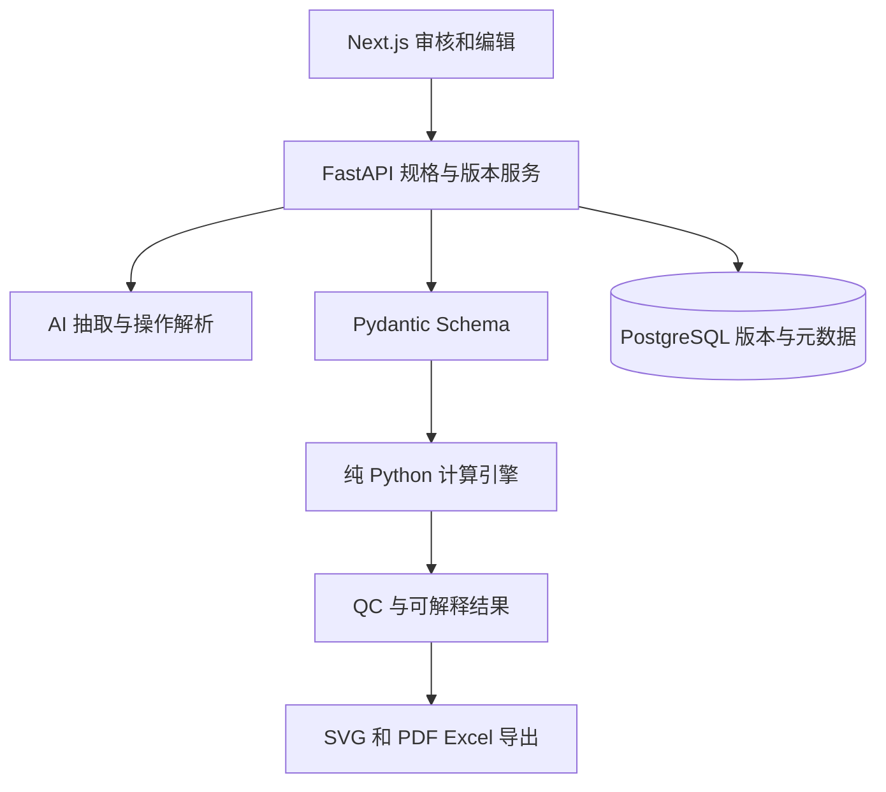

# KnitPilot 技术架构

## 总体边界

AI 只能提供识别、OCR、语义提取、受限 JSON/operation、历史检索和解释；数值结果均来自受测试的 `packages/engine`。模型输出经 Pydantic 和来源检查，不接受模型提供的针数/转数/QC；缺失为 null。API 负责身份、权限、确认、转换；引擎无网络、LLM、数据库或时钟依赖，输入相同则输出相同。

## 当前目录职责

| 路径 | 职责与当前状态 |
| --- | --- |
| `apps/api` | FastAPI `health`、`calculate`、`operations/preview` 已实现；请求校验与确认边界 |
| `apps/web` | Next.js/React/TypeScript/Tailwind 静态演示界面；手动规格录入、程序 SVG、QC、JSON 下载 |
| `packages/schemas` | Pydantic v2 契约、证据字段、版本/编辑记录 |
| `packages/engine` | 纯函数和不可变 dataclass，针/转换算、成形、QC |
| `packages/ai` | 提取和自然语言 operation 契约与校验；尚未接模型供应商 |
| `packages/renderer`, `packages/exporter` | 下一阶段可复用 SVG 与 PDF/Excel；当前演示 SVG 由前端程序绘制 |
| `database/migrations` | 下一阶段 PostgreSQL/Alembic 迁移 |
| `fixtures`, `tests` | 示范输入、引擎与 API 回归测试 |

## 数据流

1. 附件原件存对象存储，PostgreSQL 保存文件 ID、校验和、项目、租户和证据定位。OCR/视觉和历史款检索产出 `KnittingSpec` 候选；结构化校验拒绝额外字段与非法置信度。
2. 工艺师核对必填项，勾选 confirmed；密度是洗前样布值，尺寸是洗后目标值，缩水为 `洗后/洗前 - 1`。确认缺失时 API 422。
3. `apps/api/service.py` 映射为不可变 `EngineInput`；缩水数学反推，针/转取半入法整，合法化在机台/循环约束内寻找最近值。正肩假定前后片从胸宽起针，以肩宽为袖窿完成时的目标宽；落肩要求肩宽等于胸宽、袖山高度为零且袖山顶宽等于袖肥，以平袖顶直接平收。肩斜按行分组，领窝中心平收后两侧减针。生产工艺参数在真实样衣验收前属于草稿假设。
4. `calculate_spec` 组装前后片、袖片和领条；`validate_spec` 输出逐项 code/ok/detail。某项 QC 失败仍返回草稿以便人工修改；几何不可能则 422。袖山和袖窿的边长按离散轮廓近似，不能代替缝合试验。
5. 自然语言只生成 `Operation(op, path, value, reason, user)`，白名单仅允许 `/measurements/<字段>`；相对修改应由解析层结合已确认的旧值变为绝对厘米值，用户核对后应用。每次应用都完整重算并产出审计记录。当前 preview 内存执行，尚不提交版本。

## 持久化与并发设计（下一阶段）

建议表：`organizations`, `users`, `projects`, `assets`, `spec_versions`, `manual_edits`, `calculation_runs`, `qc_signoffs`。`spec_versions` 保存 UUID、project_id、parent_version_id、单调 version_no、state、schema_version、input_jsonb、engine_version、result_jsonb、created_by/at；禁止 UPDATE/DELETE 历史版本，使用 DB 约束和角色权限。写入事务先锁项目或做乐观并发检查；若 base_version 不等于最新版本，返回 409 并提示重审。修改提交时写新版本、审计和结果同一事务；final 需要所有阻断项通过和指定审核角色签署。敏感文件按组织授权访问；日志不记录图片全文。

## 企业试用演示部署

`Dockerfile` 先构建 Next.js 静态站点，再安装 FastAPI；同一个 Render Web Service 在 `/demo/` 提供界面、在 `/v1` 提供计算接口。`KNITPILOT_DEMO_TOKEN` 不进仓库，部署时由环境变量提供。共享访问码只保护演示 API，不提供个人身份、审计或组织隔离；演示界面提示只用非敏感数据。正式企业资料须在账号、存储和权限实施后再接入。

## 数值政策与单测

统一 cm、针/10cm、转/10cm、带符号缩水率。计数以 `Decimal(字符串)` 的 `ROUND_HALF_UP` 实现；合法化等距取低值；循环约束以最小公倍数合并；重复次数是单侧事件数。每侧收/放、平收、余针独立守恒。返回理论与实际差和成品宽误差；这些误差与近似缝合长度由 QC 显示。

测试包含计算示例、边界/不可行约束、守恒、对称、前后肩、袖山与袖窿、未确认字段拒绝、API 修改后重算。运行 `pytest --cov=packages.engine --cov-branch --cov-fail-under=90`。正式发布前增加属性测试、机台/组织参数表、真实成衣测量和工厂回归案例。依赖和阈值在 `pyproject.toml` 固定范围；部署时生成锁文件，密钥仅用环境变量。
